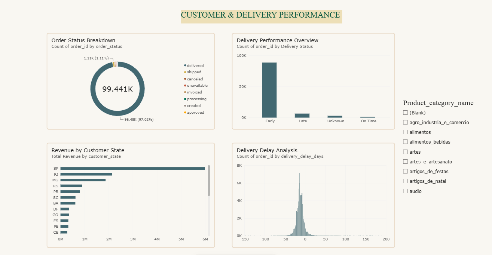
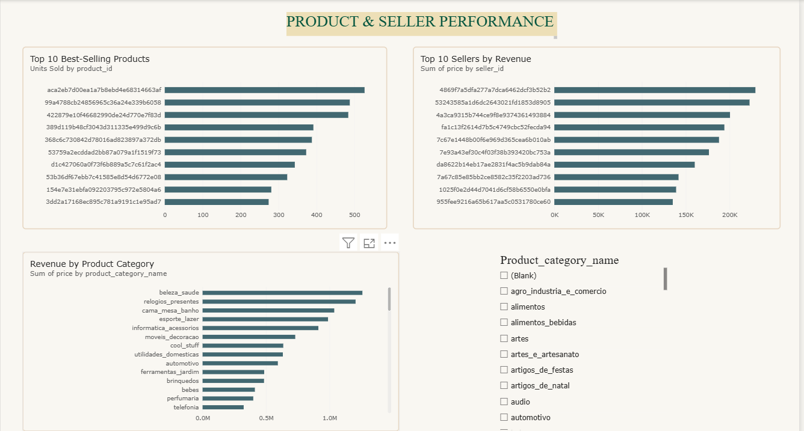
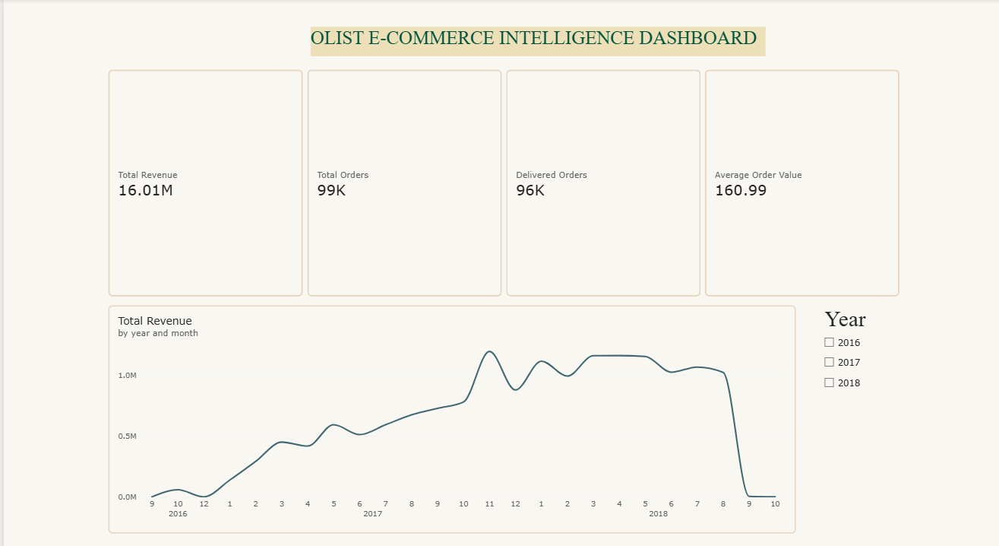

# Olist E-Commerce Intelligence Platform

An end-to-end data analytics and data engineering project built using the Olist Brazilian E-Commerce Public Dataset.

## Project Overview

This project analyses e-commerce transactions to understand sales performance, customer behaviour, product performance, seller performance, and delivery efficiency.

It demonstrates a complete data workflow, from raw dataset exploration and cleaning to SQL-based data warehousing and interactive Power BI dashboards.

## Business Objectives

- Analyse overall sales and revenue performance.
- Identify top-performing products and sellers.
- Understand customer distribution across states.
- Evaluate order status and delivery performance.
- Generate actionable insights to support business decisions.

## Technology Stack

| Technology | Purpose |
|---|---|
| Python | Data cleaning and preparation |
| Pandas & NumPy | Data manipulation and analysis |
| PostgreSQL | Database and data warehouse |
| SQL | Business analysis and querying |
| Power BI | Interactive dashboards |
| Jupyter Notebook | Data exploration |
| Git & GitHub | Version control |

## Project Architecture

1. **Data Source:** Olist Brazilian E-Commerce Public Dataset.
2. **Data Exploration:** Examined datasets, structures, missing values, and duplicates using Python.
3. **Data Cleaning:** Converted date columns, handled missing values, and prepared analytical data.
4. **Data Integration:** Combined orders, payments, customers, order items, and reviews.
5. **Data Warehousing:** Loaded data into PostgreSQL and designed a dimensional model with fact and dimension tables.
6. **Business Analysis:** Used SQL queries to analyse revenue, products, sellers, customers, and delivery performance.
7. **Visualization:** Developed interactive Power BI dashboards.

## Data Warehouse Design

The analytical warehouse includes:

### Fact Tables
- `fact_orders` — order-level information and measures.
- `fact_order_items` — individual products purchased within orders.

### Dimension Tables
- `dim_customers`
- `dim_products`
- `dim_sellers`
- `dim_date`

The two fact tables maintain different levels of detail to support accurate analysis.

## Power BI Dashboard

The interactive dashboard consists of three pages:

### 1. Executive Overview


### 2. Product & Seller Analysis


### 3. Customer & Delivery Performance

## Key Findings

- Analysed 99,441 unique orders.
- 96,478 orders were delivered.
- 625 orders were cancelled, representing approximately 0.63% of all orders.
- Average delivery duration was approximately 12.56 days.
- Among orders with known delivery outcomes, approximately 91.89% arrived early, 1.34% on the estimated date, and 6.77% arrived late.

## Repository Structure

```text
Ecommerce_Intelligence_Platform/
│
├── data/
│   └── processed/
│
├── notebooks/
│   └── 01_data_exploration.ipynb
│
├── sql/
│   └── business_analysis.sql
│
├── powerbi/
│   └── Olist_Ecommerce_Intelligence.pbix
│
├── docs/
│   ├── Project_Overview.md
│   ├── Data_Dictionary.md
│   └── Business_Insights.md
│
└── README.md
```

## Dataset

Source: [Olist Brazilian E-Commerce Public Dataset](https://www.kaggle.com/datasets/olistbr/brazilian-ecommerce)

The raw dataset is not included in this repository. Download it from Kaggle to reproduce the analysis.

## Skills Demonstrated

- Data cleaning and preprocessing
- Exploratory data analysis
- SQL joins, aggregations, and business queries
- Relational database design
- Fact and dimension modelling
- Data visualization and dashboard development
- Business insight generation

## Project Status

Completed — end-to-end data analytics and data warehousing workflow.